<div align="center">


# حلقه · Halgheh

### شبکهٔ آدم‌های تو — روی گوشی خودت
**Offline-first Persian personal CRM for Android · your people, your data, your phone**

[](docs/INSTALL.md)
[](#privacy)
[](#privacy)
[](#english)
[](#dev)
[](#dev)

[**نصب**](docs/INSTALL.md) · [**امکانات**](#features) · [**تصاویر**](#screenshots) · [**English**](#english) · [**دانلود APK**](https://github.com/javadSharifi/halgheh/releases)

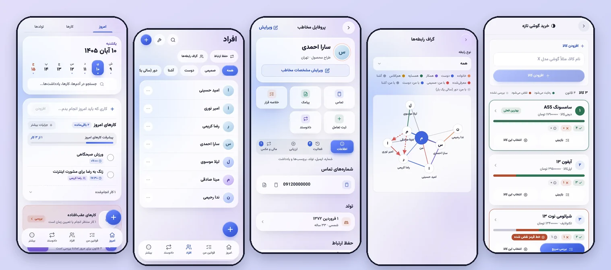

</div>

<div dir="rtl">

## حلقه چیست؟

**حلقه** یک **دفترچهٔ هوشمند آدم‌ها** (Personal CRM / مدیریت روابط شخصی) برای **اندروید** است؛ فارسی، راست‌به‌چپ، و **کاملاً آفلاین**. هر آدمی را که می‌شناسی، هر قولی که داده‌ای، هر کاری که کسی از تو خواسته، و هر قاعده‌ای که برای خودت گذاشته‌ای، یک‌جا نگه می‌دارد و به‌موقع یادت می‌اندازد.

برای کسی ساخته شده که می‌خواهد **رابطه‌هایش را فراموش نکند**: «آخرین بار کِی با مینا حرف زدم؟»، «چه کسی لوله‌کشی بلد است؟»، «رضا چقدر به من بدهکار است؟»، «کدام گوشی با قانون‌های خریدم می‌خواند؟»

> **همهٔ داده‌ها روی گوشی خودت می‌مانند.** بدون حساب کاربری، بدون تبلیغ، بدون ردیاب. همگام‌سازی ابری فقط اگر خودت روشنش کنی.

<a id="features"></a>

## ✨ امکانات

### 👥 افراد و رابطه‌ها
- **پروفایل کامل**: نام، شماره و ایمیل، شغل و شهر، تولد (**شمسی، میلادی، قمری**)، برچسب، یادداشت خصوصی و سابقهٔ تعامل‌ها. افزودن از دفترچه تلفن هم ممکن است.
- **دسته‌بندی صمیمیت و حفظ ارتباط**: هر نفر را «صمیمی، دوست، آشنا یا دور» کن و برای او ریتم تماس بگذار (هر ۱۴ روز، ماهی یک بار، **سالی یک بار**…). حلقه می‌گوید از چه کسانی **خیلی وقت است خبر نداری** و هر وقت خواستی یک هفته عقبش می‌اندازد.
- **گراف رابطه‌ها**: تو در مرکز هستی و همه به تو وصل‌اند (رنگ خط = میزان صمیمیت). رابطهٔ آدم‌ها با هم (خانواده، دوست، همکار، همسایه…) و **اینکه چه کسی چه کسی را به چه کسی معرفی کرده** هم دیده می‌شود. معرف اختیاری است.
- **مهارت و شواهد**: هر کس چه کاری بلد است، با سطح و سال تجربه و اینکه خودت دیده‌ای یا فقط ادعا کرده؛ مهارت تأییدنشدهٔ قدیمی «کهنه» علامت می‌خورد.
- **«چه کسی می‌تواند؟»**: مهارت را بنویس (مثلاً «لوله‌کشی») تا بدانی چه کسی بلد است، و اگر خودت کسی را نمی‌شناسی، چه کسی می‌تواند **معرفی کند**.
- **خلاصهٔ قبل از قرار**: قبل از دیدن یک نفر، آخرین گفتگوها، کارهای باز و حساب مالی با او را یک‌جا ببین.

### ✅ کارها و روزها
- **امروز**: کارهای امروز، عقب‌افتاده‌ها، تولدهای هفته و «چه کسی را صدا بزنم»؛ با تب‌های **امروز | کارها | تولدها**.
- **کار یک‌باره و تکرارشونده** (روزهای دلخواه هفته)، ساعت و **یادآوری اعلان**، تعویق یادآوری، و «چه کسی خواسته».
- **انواع کار**: شخصی، **خرید**، کار اداری و بیرون، سلامت و ورزش.
- **دکمهٔ «+» سراسری** برای افزودن سریع کار، فرد، دادوستد، تولد یا قانون از هر صفحه.
- **ویجت‌های صفحهٔ اصلی اندروید** برای کارهای امروز و رویدادهای پیش‌رو.
- **مرور هفتگی**: این هفته با چه کسانی حرف زدی، چند کار انجام دادی، چه قانونی را بیشتر شکستی، و هفتهٔ بعد چه خبر است.

### 🛒 خرید هوشمند و مقایسهٔ محصول
- برای یک کار «خرید» **قوانین خرید** بنویس («حداقل ۸ گیگ رم»، «گارانتی دارد») و **چند محصول** (مثلاً چند گوشی) وارد کن.
- هر محصول با قوانین سنجیده می‌شود: نوار رنگی رعایت‌شده/نقض‌شده/بررسی‌نشده، **«بهترین فعلی»**، هشدار **خط قرمز**، ماتریس کامل، و **مقایسهٔ رودررو** دو محصول. در پایان یکی را با دلیلش انتخاب کن.

### 📜 قوانین من
- قاعده‌های شخصی‌ات را بنویس و در **مرور با فاصله‌گذاری** (Spaced Repetition) هر چند وقت یک بار مرورشان کن.
- **ثبت شکست**: هر بار قانونی را شکستی، چرا و برنامهٔ دفعهٔ بعد را بنویس؛ حلقه می‌گوید کدام قانون را بیشتر از همه می‌شکنی.
- **بررسی قوانین هر آدم**: قانون‌هایت را دربارهٔ یک رابطه تیک بزن.

### 💸 دادوستد
- قرض، بدهی، امانت و لطف‌های متقابل؛ **تسویهٔ کامل یا قسطی**، موعد بازپرداخت، تراز خالص و تراز هر نفر.

### 🎂 تولد و مناسبت
- تولدها و مناسبت‌های سالانه (نوروز، سالگرد…) در سه تقویم، با یادآوری چند روز زودتر.
- **متن تبریک آماده** (متناسب با جنسیت) و ارسال با **پیامک، واتساپ، تلگرام، ایمیل**، سایر برنامه‌ها یا کپی؛ و با یک دکمه می‌توانی فرستادنش را به‌عنوان تعامل ثبت کنی.

### 🖼️ گالری
- عکس‌ها روی گوشی **فشرده** می‌شوند و همان لحظهٔ افزودن، عنوان، یادداشت، تاریخ، شخص و برچسب می‌گیرند.
- **جستجو** در عنوان، یادداشت، نام شخص و برچسب، و نمایش **دسته‌بندی‌شده بر اساس شخص**. از پروفایل هر فرد هم می‌توانی عکس بگذاری یا ببینی و پاک کنی.

### 🔒 امنیت و پشتیبان
- **قفل برنامه** با پین و اثر انگشت و جلوگیری از اسکرین‌شات.
- **پشتیبان کامل** (JSON یا ZIP همراه عکس‌ها) و بازیابی از فایل.
- حالت **تیره و روشن**، رابط **فارسی و انگلیسی**، فونت وزیرمتن.

<a id="screenshots"></a>

## 📱 تصاویر برنامه

<table>
  <tr>
    <td align="center" width="25%">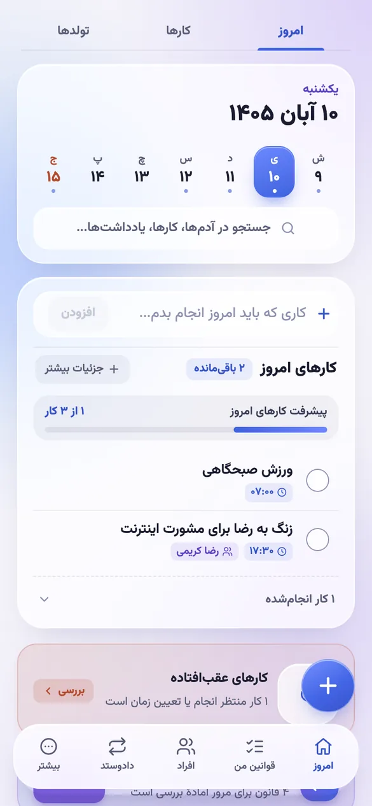<br /><sub><b>امروز</b><br />کارها، تقویم و پیگیری</sub></td>
    <td align="center" width="25%">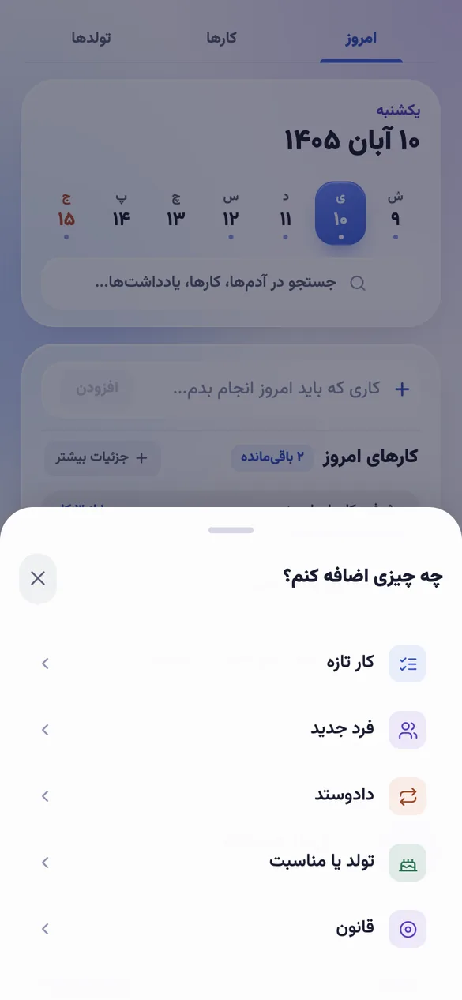<br /><sub><b>افزودن سریع</b><br />از هر صفحه</sub></td>
    <td align="center" width="25%">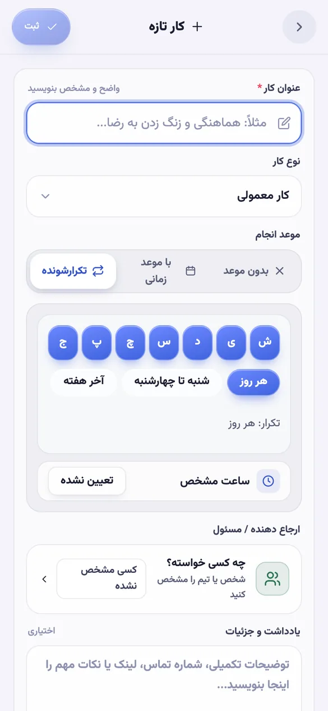<br /><sub><b>کار تکرارشونده</b><br />روزهای دلخواه هفته</sub></td>
    <td align="center" width="25%">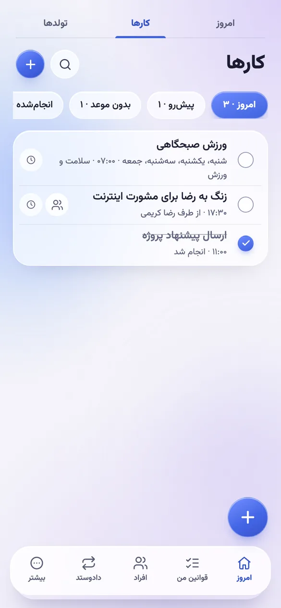<br /><sub><b>کارها</b><br />فیلتر و انواع کار</sub></td>
  </tr>
  <tr>
    <td align="center">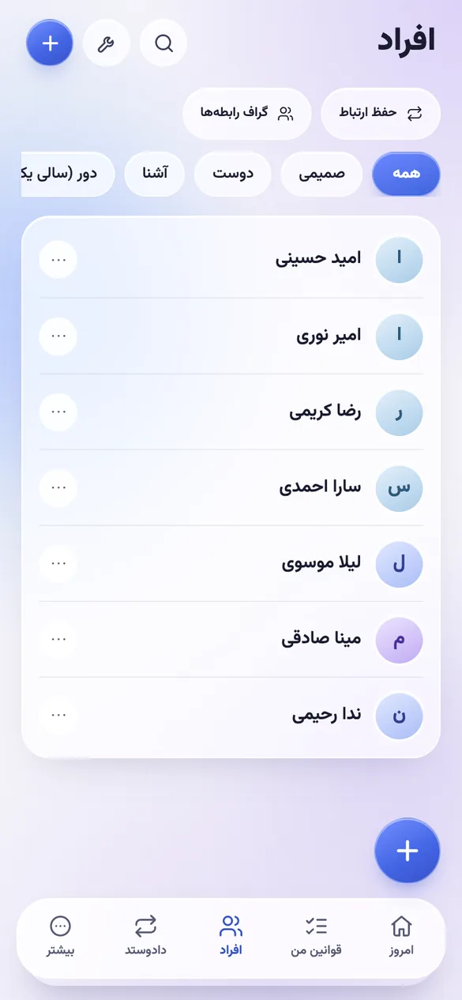<br /><sub><b>افراد</b><br />دسته‌بندی صمیمیت</sub></td>
    <td align="center">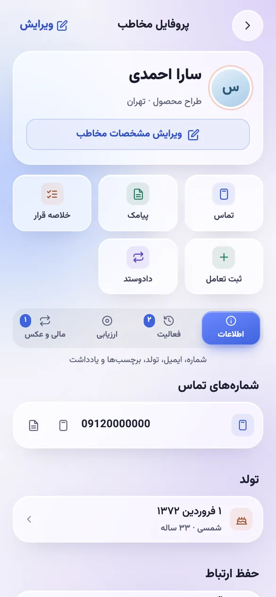<br /><sub><b>پروفایل</b><br />میان‌بر و بخش‌ها</sub></td>
    <td align="center">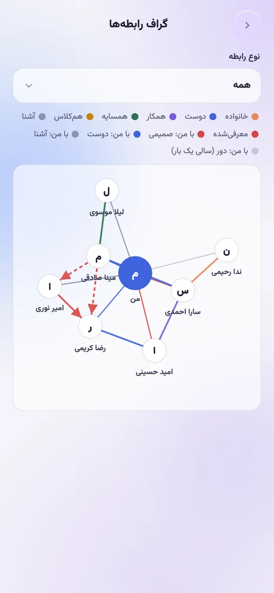<br /><sub><b>گراف رابطه‌ها</b><br />کی به کی وصل است</sub></td>
    <td align="center">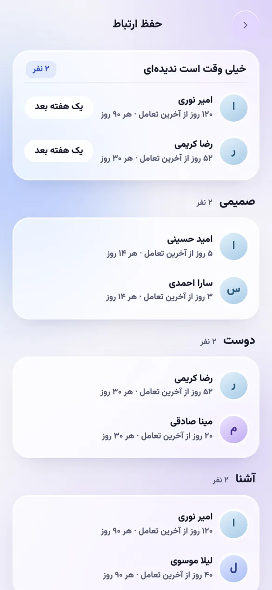<br /><sub><b>حفظ ارتباط</b><br />چه کسی را صدا بزنم</sub></td>
  </tr>
  <tr>
    <td align="center">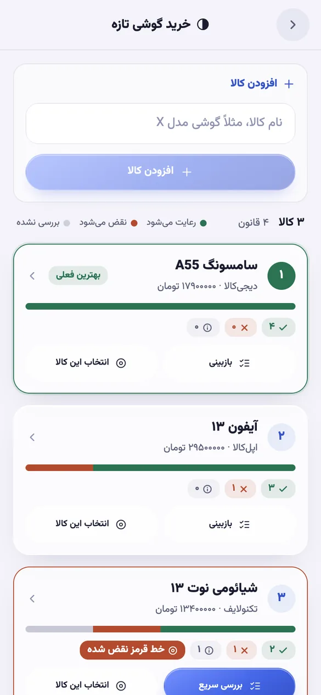<br /><sub><b>مقایسهٔ خرید</b><br />بهترین فعلی و خط قرمز</sub></td>
    <td align="center">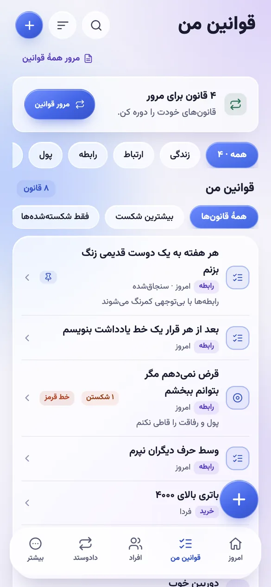<br /><sub><b>قوانین من</b><br />مرور و ثبت شکست</sub></td>
    <td align="center">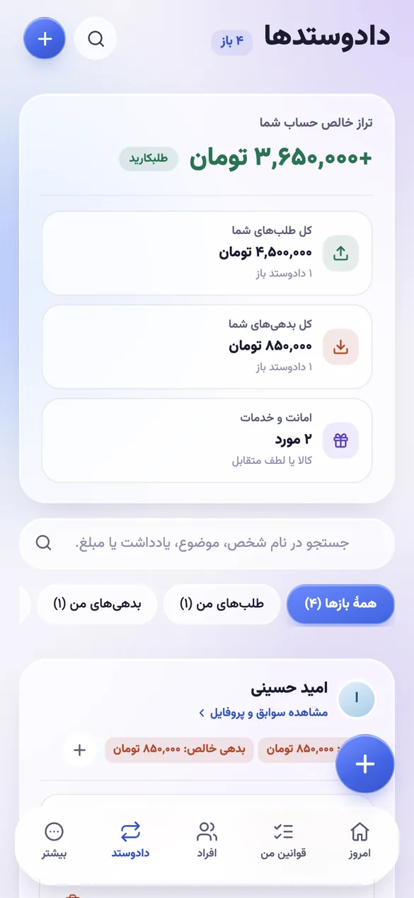<br /><sub><b>دادوستد</b><br />طلب، بدهی، امانت</sub></td>
    <td align="center">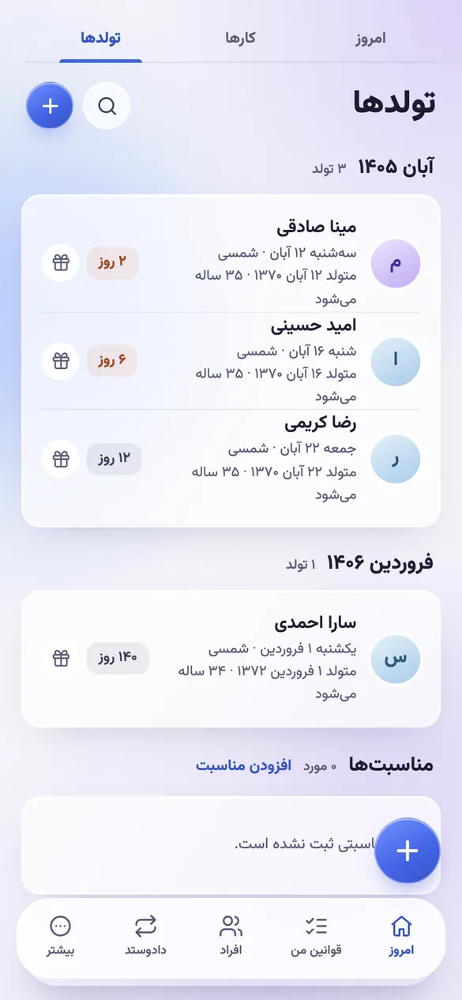<br /><sub><b>تولدها</b><br />سه تقویم و تبریک</sub></td>
  </tr>
  <tr>
    <td align="center">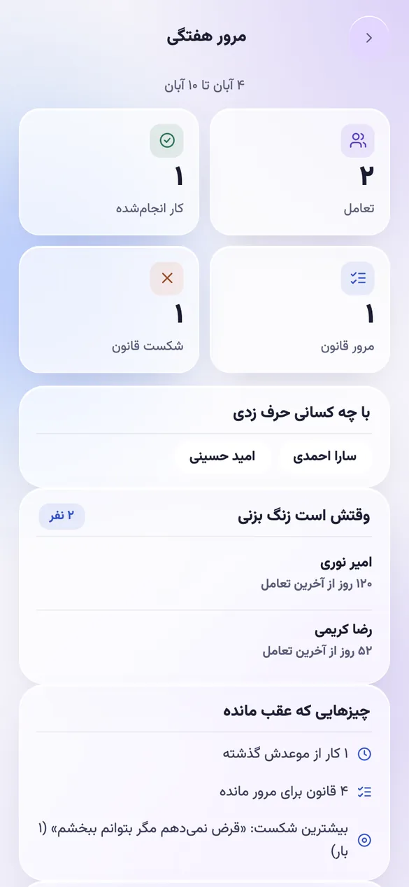<br /><sub><b>مرور هفتگی</b><br />هفته در یک نگاه</sub></td>
    <td align="center">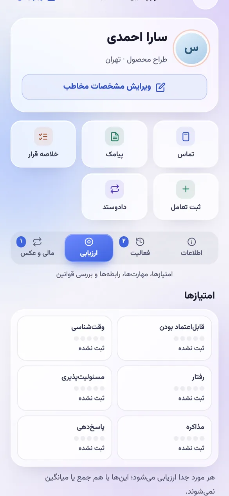<br /><sub><b>ارزیابی</b><br />امتیاز، مهارت، رابطه</sub></td>
    <td align="center">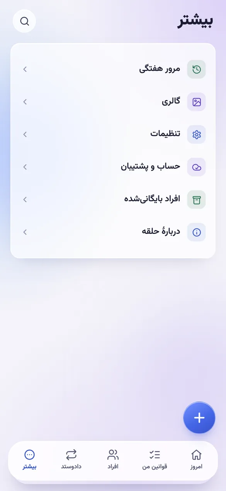<br /><sub><b>بیشتر</b><br />گالری، تنظیمات، پشتیبان</sub></td>
    <td align="center">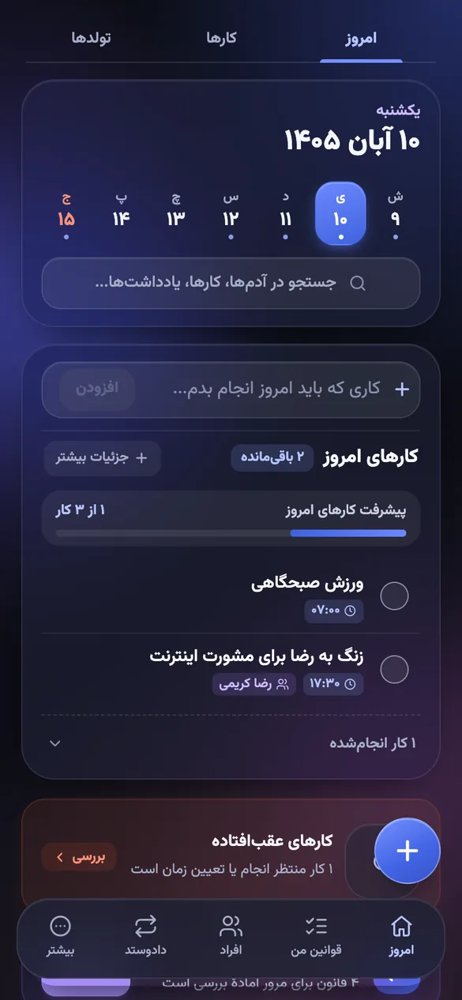<br /><sub><b>حالت تیره</b><br />برای شب</sub></td>
  </tr>
</table>

<sub>همهٔ نام‌ها و عددها در تصاویر **ساختگی** و برای نمایش‌اند.</sub>

## 📥 نصب

حلقه در گوگل‌پلی **نیست**؛ فایل APK را مستقیم نصب می‌کنی. نیاز: **اندروید ۷ (API 24) یا بالاتر**.

1. آخرین `halgheh-vX.Y.Z.apk` را از [**Releases**](https://github.com/javadSharifi/halgheh/releases) دانلود کن.
2. فایل را باز کن و اجازهٔ «نصب از این منبع» را بده.
3. نصب را بزن. دفترچه از خالی شروع می‌شود و **هیچ حساب یا ثبت‌نامی لازم نیست**.

راهنمای قدم‌به‌قدم و رفع مشکل: [**docs/INSTALL.md**](docs/INSTALL.md)

> ⚠️ **پشتیبان بگیر.** داده‌ها فقط روی گوشی‌اند؛ با گم شدن گوشی یا پاک کردن برنامه، بدون پشتیبان برنمی‌گردند. «تنظیمات ← داده و همگام‌سازی ← پشتیبان کامل».

<a id="privacy"></a>

## 🔐 حریم خصوصی

- همهٔ داده‌ها روی **گوشی خودت** ذخیره می‌شوند و برنامه بدون اینترنت کامل کار می‌کند.
- **هیچ تحلیل‌گر، تبلیغ یا ردیابی** در برنامه نیست. بدون `VITE_SYNC_URL` هیچ بخش شبکه‌ای در برنامه دیده نمی‌شود.
- **همگام‌سازی ابری اختیاری است** و فقط برای پشتیبان‌گیری و چند دستگاه. **توجه:** داده‌ی همگام‌شده روی سرور **رمزنگاری نمی‌شود** و برنامه همین را قبل از فعال‌سازی می‌گوید. رمز حساب هم قابل بازیابی نیست.
- عکس‌ها فقط روی گوشی می‌مانند و جز با «آپلود فایل‌ها» (اختیاری) از آن بیرون نمی‌روند.

## ❓ پرسش‌های پرتکرار

**حلقه به اینترنت نیاز دارد؟** نه. همهٔ امکانات آفلاین کار می‌کنند. فقط همگام‌سازی اختیاری از شبکه استفاده می‌کند.

**فرق حلقه با دفترچه تلفن چیست؟** دفترچه تلفن فقط شماره نگه می‌دارد. حلقه **سابقهٔ تعامل، قول‌ها، بدهی‌ها، مهارت‌ها، رابطه‌ها و ریتم تماس** را هم نگه می‌دارد و یادآوری می‌کند.

**برای iPhone هست؟** فعلاً فقط **اندروید**. نسخهٔ وب برای توسعه اجرا می‌شود (`pnpm dev`) ولی عکس، اعلان و مخاطبین در آن غیرفعال‌اند.

**داده‌ها را می‌شود به گوشی جدید برد؟** بله، با پشتیبان ZIP یا با همگام‌سازی اختیاری.

**تقویم شمسی پشتیبانی می‌شود؟** بله؛ **شمسی (جلالی)، میلادی و قمری** برای تولد، کار و مناسبت.

<a id="dev"></a>

## 🛠️ برای توسعه‌دهندگان

**پشتهٔ فنی:** React 19 · TypeScript (strict) · Vite · Dexie (IndexedDB) · Capacitor 8 (اندروید) · Cloudflare Workers + D1 (همگام‌سازی اختیاری) · Vitest

```bash
pnpm install     # نیاز: Node 22 و pnpm 9
pnpm dev         # سرور توسعه
pnpm verify      # تایپ‌چک + تست (حین کار)
pnpm i18n        # بررسی کلیدهای ترجمهٔ فارسی ← انگلیسی
pnpm build       # خروجی production
```

```bash
pnpm android:apk      # APK دیباگ
pnpm android:release  # APK امضاشده → release/halgheh.apk
pnpm android:live     # اجرا روی گوشی/شبیه‌ساز با hot reload
```

**معماری در یک نگاه:** برنامه **offline-first** است؛ همهٔ ردیف‌ها با `id` (UUID) و `updatedAt` در Dexie ذخیره می‌شوند و همگام‌سازی فقط تغییرات را به یک Worker می‌فرستد. منطق خالص در `src/domain/*`، صفحه‌ها در `src/*.tsx` و مسیریابی در یک ماشین حالت (`src/App.tsx`). متن‌ها با `tx('…')` ترجمه می‌شوند (کلید = متن فارسی).

<details>
<summary><b>همگام‌سازی اختیاری (Cloudflare Worker + D1)</b></summary>

```bash
pnpm exec wrangler login
pnpm exec wrangler d1 create halgheh      # database_id را در wrangler.jsonc بگذار
pnpm exec wrangler d1 migrations apply halgheh --remote
pnpm build && pnpm exec wrangler deploy
```

آدرس Worker در `.env.production`: `VITE_SYNC_URL=https://halgheh.<you>.workers.dev`. تست سرور: `pnpm exec wrangler dev --port 8799` و `node scripts/smoke-sync.mjs http://127.0.0.1:8799`.
</details>

<details>
<summary><b>انتشار نسخه (APK امضاشده)</b></summary>

با ساختن تگ `vX.Y.Z` یا اجرای دستی workflow «Build & Release Android APK»، APK امضاشده ساخته و به Releases اضافه می‌شود (`1.2.3 → versionCode 10203`). این secretها لازم‌اند: `RELEASE_KEYSTORE_BASE64`، `STORE_PASSWORD`، `KEY_ALIAS`، `KEY_PASSWORD`. کلید امضا هرگز داخل مخزن نمی‌آید؛ جزئیات در [docs/KEYSTORE.md](docs/KEYSTORE.md).
</details>

### مستندات
[راهنمای نصب](docs/INSTALL.md) · [همگام‌سازی و تعارض](docs/SYNC.md) · [بازبینی فنی](docs/AUDIT.md) · [کلید امضا](docs/KEYSTORE.md)

</div>

---

<a id="english"></a>

## English

**Halgheh (حلقه, “the ring”)** is an **offline-first personal CRM for Android with a Persian (Farsi, right-to-left) interface** and an English UI option. It keeps everyone you know, the favours you owe and are owed, the rules you set for yourself, and your shopping decisions in one place — **entirely on your phone**.

**Highlights**

- **People & relationships** — profiles, closeness groups (close / friend / acquaintance / distant) with a *keep-in-touch* rhythm, a **relationship graph** with you at the centre and optional “who introduced whom”, skills with evidence, and a *who can do this?* search.
- **Tasks** — one-off and **recurring** tasks, reminders, task types, a global “+” button, home-screen widgets and a **weekly review**.
- **Smart shopping** — write shopping rules, add several products (e.g. phones) and compare them against the rules, with a “best so far” pick, hard-fail rules and a head-to-head view.
- **My rules** — personal rules with spaced-repetition review and a broken-rule log.
- **Ledger** — money, items and favours, with partial settlement and balances.
- **Birthdays & occasions** in the **Jalali (Persian), Gregorian and Hijri calendars**, with ready wish texts you can send by SMS, WhatsApp, Telegram or email.
- **Gallery** with per-photo details, search, and grouping by person.
- **Private by design** — no ads, no analytics, PIN/fingerprint lock, full ZIP backup. Cloud sync is optional and **not end-to-end encrypted** (the app tells you before you enable it).

**Install:** download the APK from [Releases](https://github.com/javadSharifi/halgheh/releases) (Android 7+), then follow [docs/INSTALL.md](docs/INSTALL.md).
**Build:** `pnpm install && pnpm dev` (Node 22, pnpm 9). Stack: React 19, TypeScript, Vite, Dexie, Capacitor, Cloudflare Workers + D1.

<sub>Keywords: personal CRM, offline-first, Android app, Persian, Farsi, RTL, Jalali calendar, Shamsi, Hijri, contacts manager, relationship manager, keep in touch reminders, relationship graph, task manager, recurring tasks, shopping comparison, spaced repetition, ledger, debt tracker, birthday reminders, private, no tracking, Capacitor, React, Dexie, Cloudflare Workers.</sub>
